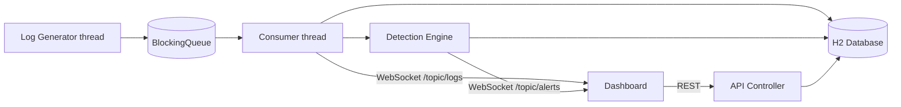

# 🛡️ LogSentinel — Real-Time Log Aggregator & Threat Monitor

A mini Splunk/Datadog-style tool that ingests a live stream of server logs, detects
threats in real time, and streams alerts to a dark-mode dashboard over WebSockets.

## 🛡️ LogSentinel — Dashboard Preview

A mini Splunk/Datadog-style tool that ingests ...

## Features
- Multi-threaded producer–consumer pipeline built on `BlockingQueue`
- Rule-based detection engine:
    - `SQL_INJECTION` (CRITICAL), generic `ERROR_EVENT` (MEDIUM)
    - `BRUTE_FORCE` (HIGH): 5 failed logins from one IP within 5 seconds (sliding window)
- Persistence with Spring Data JPA + H2, scheduled cleanup of old data
- REST API: `/api/logs`, `/api/alerts`, `/api/stats`
- Live dashboard (Tailwind + Chart.js) updated via STOMP over WebSocket

## Architecture


## Tech stack
Java 21 · Spring Boot · Spring Data JPA · H2 · WebSocket (STOMP) · Tailwind CSS · Chart.js · JUnit 5

## Run locally
```bash
./mvnw spring-boot:run
```
Open http://localhost:8080

## Project structure
`controller` · `service` · `repository` · `model` · `config` · `generator` · `detection`

## Roadmap
- ML-based anomaly detection (Isolation Forest / autoencoder) on log patterns
- Docker support

# Author:
  SinghWhoDevelops

# Status:
  Completed
